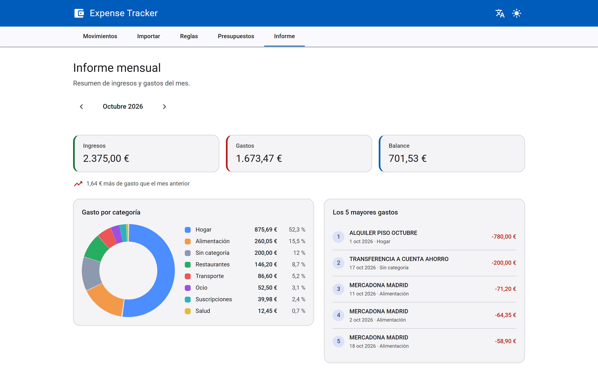

# Expense Tracker · API

<!-- La cobertura es el dato real del último `./mvnw verify` (JaCoCo): si cambia, se actualiza a mano. -->


API REST para controlar los gastos personales: importa el extracto del banco en CSV, categoriza los movimientos con reglas, gestiona presupuestos mensuales por categoría y genera un informe de cada mes.

La interfaz en Angular está en [expense-tracker-frontend](https://github.com/DavidLC500/expense-tracker-frontend).



## Funcionalidades

- Importación de CSV sin duplicados: reimportar el mismo extracto no repite movimientos.
- Categorización automática con reglas de texto; la categoría se puede corregir a mano.
- Movimientos paginados con filtros por mes, categoría y texto.
- Presupuestos mensuales por categoría.
- Informe mensual: ingresos, gastos, balance y gasto por categoría.

## Tecnologías

Java 21, Spring Boot 3.5, PostgreSQL 16, Flyway, MapStruct, springdoc-openapi, JUnit 5, Testcontainers y Docker. Arquitectura hexagonal.

## Cómo arrancarlo

Requiere Docker. Clona los dos repositorios en la misma carpeta y levanta todo desde este:

```bash
git clone https://github.com/DavidLC500/expense-tracker-backend.git
git clone https://github.com/DavidLC500/expense-tracker-frontend.git
cd expense-tracker-backend
docker compose up --build
```

- App: http://localhost:8081
- API: http://localhost:8080
- Swagger UI: http://localhost:8080/swagger-ui/index.html

Para probar la importación hay un CSV de ejemplo (columnas `fecha,concepto,importe`):

```bash
curl -F "file=@examples/movimientos-ejemplo.csv" http://localhost:8080/api/transactions/import
```

## Tests

```bash
./mvnw verify
```

Ejecuta los tests (los de integración levantan PostgreSQL con Testcontainers, así que Docker debe estar en marcha) y las comprobaciones de formato, estilo, análisis estático, arquitectura y cobertura.

## Licencia

[MIT](LICENSE)
