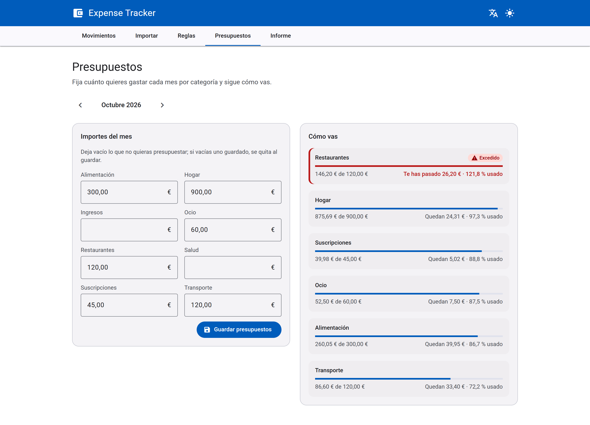
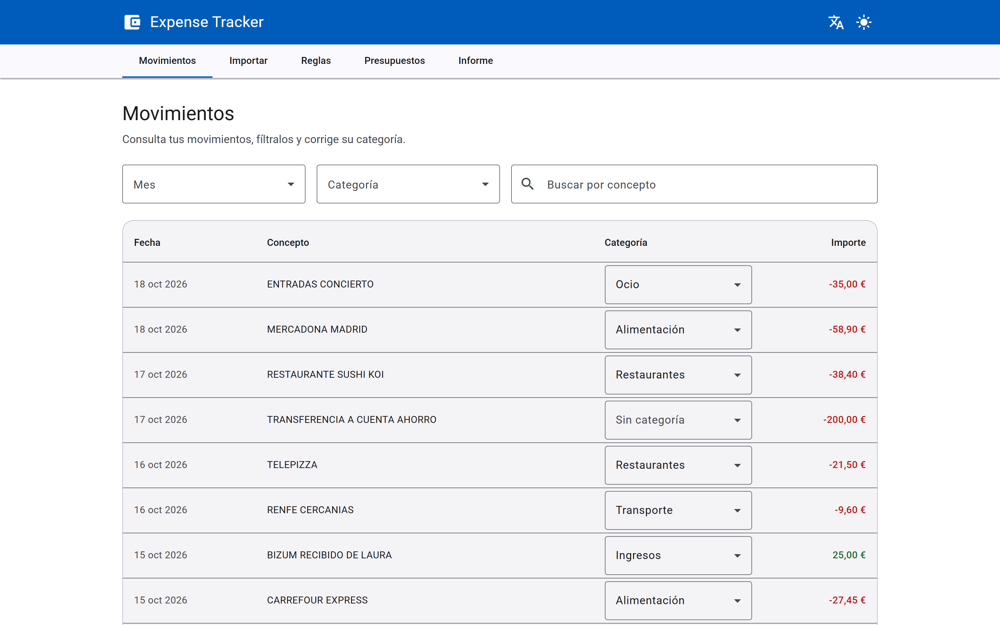
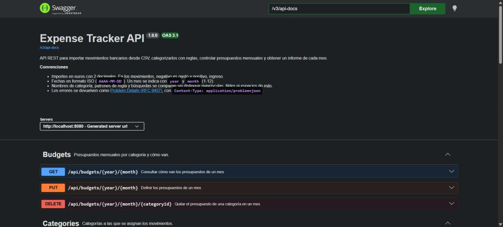
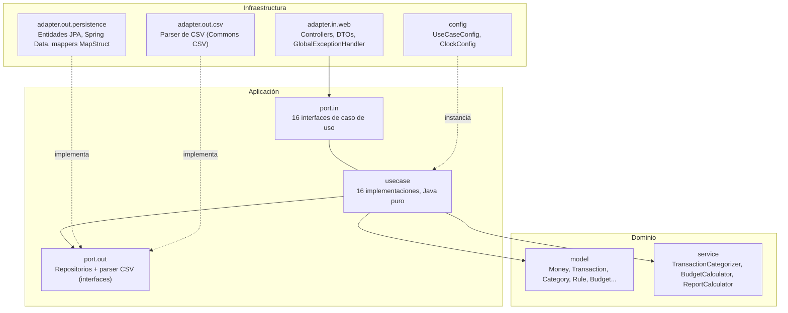
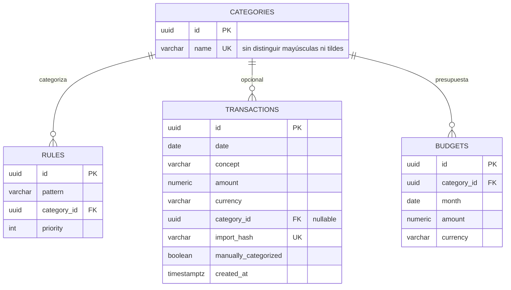

# Expense Tracker · API

<!-- La cobertura es el dato real del último `./mvnw verify` (JaCoCo): si cambia, se actualiza a mano. -->


Aplicación full-stack para controlar los gastos personales: importa el extracto del banco en CSV, categoriza cada movimiento con reglas, fija presupuestos por categoría y muestra un informe de cada mes.

Este repositorio es la **API REST**: Java 21, Spring Boot 3, PostgreSQL y arquitectura hexagonal. La interfaz en Angular está en [expense-tracker-frontend](https://github.com/DavidLC500/expense-tracker-frontend), y un solo `docker compose up --build` levanta las dos.

## Capturas


<table>
  <tr>
    <td width="50%"></td>
    <td width="50%"></td>
  </tr>
  <tr>
    <td align="center">Presupuestos del mes, con los excedidos primero</td>
    <td align="center">Movimientos, con la categoría editable en cada fila</td>
  </tr>
</table>

Con datos de ejemplo. Más capturas (importación, móvil, tema oscuro e inglés) en el [repositorio del frontend](https://github.com/DavidLC500/expense-tracker-frontend#capturas).

## Funcionalidades

- **Importación de CSV idempotente.** Reimportar el mismo extracto no duplica nada, tampoco con dos importaciones a la vez. Una fila inválida no detiene el resto: se informa con su número y el motivo.
- **Categorización automática** con reglas por texto, sin distinguir mayúsculas ni tildes, y con prioridad. Al reaplicar las reglas se respetan las correcciones manuales, que se pueden deshacer.
- **Consulta de movimientos** paginada y con filtros combinables: mes (solo los que tienen movimientos), categoría, sin categoría y texto.
- **Presupuestos mensuales** por categoría: crear, cambiar y quitar, con lo gastado, lo que queda, el porcentaje usado y si se ha excedido.
- **Informe mensual**: ingresos, gastos, balance, comparación con el mes anterior, gasto por categoría y los 5 mayores gastos.
- **Errores estándar** en formato Problem Details (RFC 9457) y API documentada con OpenAPI (Swagger UI).

## Calidad

- **298 tests**: dominio, casos de uso con repositorios en memoria, persistencia contra un PostgreSQL real (Testcontainers), controllers (`@WebMvcTest`), contrato OpenAPI y un test de extremo a extremo que importa el CSV de ejemplo contra la API completa. El frontend suma 218 tests unitarios y 4 E2E con Playwright.
- **97,7 % de cobertura de líneas** (el build exige un mínimo del 85 %).
- `./mvnw verify` falla si se rompe la arquitectura (ArchUnit), el formato (Spotless), el estilo (Checkstyle), el análisis estático (SpotBugs) o la cobertura mínima (JaCoCo). GitHub Actions lo ejecuta en cada push y construye la imagen Docker.

## Swagger UI

Captura real de `/swagger-ui/index.html` con la API completa arrancada contra PostgreSQL:



## Endpoints

| Método | Ruta | Para qué |
|---|---|---|
| `POST` | `/api/transactions/import` | Importar un CSV |
| `GET` | `/api/transactions` | Listar movimientos con filtros y paginación |
| `GET` | `/api/transactions/months` | Meses con movimientos y cuántos tiene cada uno |
| `PATCH` | `/api/transactions/{id}` | Corregir la categoría a mano |
| `DELETE` | `/api/transactions/{id}/manual-category` | Deshacer la corrección manual |
| `POST` | `/api/transactions/recategorize` | Reaplicar las reglas a lo ya importado |
| `GET` `POST` | `/api/categories` | Listar y crear categorías |
| `GET` `POST` | `/api/rules` | Listar y crear reglas |
| `DELETE` | `/api/rules/{id}` | Borrar una regla |
| `GET` `PUT` | `/api/budgets/{year}/{month}` | Estado y definición de los presupuestos del mes |
| `DELETE` | `/api/budgets/{year}/{month}/{categoryId}` | Quitar el presupuesto de una categoría |
| `GET` | `/api/reports/{year}/{month}` | Informe mensual |

El detalle de cada uno (parámetros, ejemplos y errores) está en Swagger UI.

## Cómo arrancarlo

Requiere [Docker](https://www.docker.com/) (con Docker Compose). Se clonan los dos repositorios en la misma carpeta y un solo comando levanta PostgreSQL, la API y el frontend, aplica las migraciones de Flyway y deja todo listo:

```bash
git clone https://github.com/DavidLC500/expense-tracker-backend.git
git clone https://github.com/DavidLC500/expense-tracker-frontend.git
cd expense-tracker-backend
docker compose up --build
```

- App (frontend): http://localhost:8081 — necesita el repositorio `expense-tracker-frontend` en la carpeta hermana de este.
- API: http://localhost:8080
- Swagger UI: http://localhost:8080/swagger-ui/index.html
- Healthcheck: http://localhost:8080/actuator/health

Para pararlo: `docker compose down` (los datos se conservan en el volumen de Postgres). Para empezar de cero: `docker compose down -v`, que borra también ese volumen.

Las credenciales de la base de datos son configurables por variables de entorno (ver `.env.example`); por defecto usa valores de desarrollo, sin secretos reales en el repositorio.

### Lanzar los tests

```bash
./mvnw clean verify
```

Esto ejecuta: tests unitarios, tests de integración contra un PostgreSQL real levantado automáticamente por **Testcontainers** (requiere Docker en marcha), el test de arquitectura (ArchUnit), y los gates de calidad (Spotless, Checkstyle, SpotBugs, cobertura mínima JaCoCo).

### Atajos (Makefile)

```bash
make build        # compila
make test         # tests unitarios y de integración
make verify       # build completo + gates de calidad
make format       # aplica formato (Spotless)
make run          # arranca la API con ./mvnw spring-boot:run
make docker-up    # docker compose up --build
make docker-down  # docker compose down (conserva los datos)
make docker-reset # docker compose down -v (borra el volumen de Postgres)
```

## Arquitectura hexagonal

El dominio no depende de nada externo — ni de Spring, ni de JPA, ni de ningún framework. Las dependencias siempre apuntan hacia dentro, y esto no es solo una convención documentada: un test de **ArchUnit** falla el build si se viola.



**Reglas verificadas por ArchUnit:**
- `domain` no depende de `application` ni de `infrastructure`.
- `application` no depende de `infrastructure`.
- Ni `domain` ni `application` importan `org.springframework.*` ni `jakarta.persistence.*`.

## Modelo de datos

4 tablas y 7 migraciones de Flyway: `V1` a `V4` crean las tablas en orden de dependencia por clave foránea, `V5` activa `unaccent` (búsquedas sin tildes), `V6` añade la marca de corrección manual y `V7` impide categorías repetidas aunque cambien las mayúsculas, las tildes o los espacios.



Índices en `transactions(date)` y `transactions(category_id, date)`; `budgets` tiene una restricción única `(category_id, month)`, y `categories` un índice único sobre el nombre normalizado.

## Decisiones técnicas

**¿Por qué arquitectura hexagonal?** Para que las reglas de negocio (categorización, cálculo de presupuestos e informes) se puedan testear y entender sin arrancar Spring ni una base de datos, y para poder cambiar de PostgreSQL a otro motor, o de REST a otro protocolo, sin tocar el dominio. No es solo una aspiración: un test de ArchUnit lo hace cumplir en cada build.

**¿Por qué `BigDecimal` y no `double`/`float`?** El dinero no admite errores de redondeo binario. El value object `Money` reescala siempre al número de decimales de la divisa usando `RoundingMode.HALF_EVEN` ("redondeo bancario"), que evita el sesgo acumulativo que introduciría redondear siempre hacia arriba en series largas de transacciones.

**¿Por qué el dominio está separado de las entidades JPA?** `Transaction` (dominio) y `TransactionEntity` (JPA) son clases distintas, traducidas explícitamente por un mapper de MapStruct. Esto permite que el dominio siga siendo Java puro e inmutable (records) mientras la entidad JPA es mutable con constructor protegido (lo que exige Hibernate) — cada una optimizada para su propio trabajo, sin comprometer ninguna de las dos.

**¿Por qué la importación de CSV es idempotente?** Reimportar el mismo extracto bancario (por error, o porque el banco lo reenvía) no debe duplicar movimientos. Cada fila se hashea (SHA-256 de fecha + concepto + importe + índice de duplicado dentro del propio fichero, para distinguir dos cafés idénticos el mismo día) y se usa como clave de idempotencia. Los movimientos se insertan en lotes con `INSERT ... ON CONFLICT (import_hash) DO NOTHING`, sin consultar antes si cada fila existe: así dos importaciones simultáneas del mismo fichero tampoco pueden duplicar nada, y 1 MB de CSV (decenas de miles de filas) no son decenas de miles de viajes a la base de datos.

**¿Por qué Flyway con `ddl-auto=validate`?** El esquema de base de datos es código versionado, revisable en PR, con historial explícito — no algo que Hibernate genera "mágicamente" a partir de las entidades. `validate` solo comprueba que las entidades coincidan con lo que las migraciones ya crearon; nunca modifica el esquema él solo, ni en desarrollo ni en producción.

**¿Por qué los adaptadores `@Repository` no son `final`?** Descubierto como bug real durante el desarrollo: Spring genera un proxy CGLIB sobre estas clases (traducción de excepciones de persistencia, `proxyTargetClass=true` por defecto en Spring Boot), y CGLIB no puede heredar de una clase `final`. Una clase `final` ahí rompe el arranque completo de la aplicación.

## Ejemplo de uso con `curl`

```bash
# 1. Crear una categoría. El cuerpo va en un fichero UTF-8: en Windows, curl envía el texto de
#    -d '...' en la codificación del sistema y la tilde no llegaría como UTF-8 (400).
curl -X POST http://localhost:8080/api/categories \
  -H "Content-Type: application/json" \
  -d @examples/categoria-alimentacion.json
# -> {"id":"<uuid>","name":"Alimentación"}

# 2. Crear una regla de categorización automática (usa el id anterior)
curl -X POST http://localhost:8080/api/rules \
  -H "Content-Type: application/json" \
  -d '{"pattern":"Mercadona","categoryId":"<uuid-de-la-categoria>","priority":1}'

# 3. Importar el CSV de ejemplo (examples/movimientos-ejemplo.csv)
curl -X POST http://localhost:8080/api/transactions/import \
  -F "file=@examples/movimientos-ejemplo.csv"
# -> {"imported":7,"duplicatesIgnored":0,"errors":[]}

# 4. Consultar el informe de enero 2026
curl http://localhost:8080/api/reports/2026/1

# 5. Reimportar el mismo CSV: ahora todo son duplicados (idempotencia)
curl -X POST http://localhost:8080/api/transactions/import \
  -F "file=@examples/movimientos-ejemplo.csv"
# -> {"imported":0,"duplicatesIgnored":7,"errors":[]}
```

Todos los comandos de este ejemplo están verificados contra la API real corriendo en Docker, no son una simulación.

## Stack

| Área | Elección |
|---|---|
| Lenguaje | Java 21 |
| Framework | Spring Boot 3.5 |
| Base de datos | PostgreSQL 16 + Flyway |
| Mapeo | MapStruct (solo en adaptadores) |
| CSV | Apache Commons CSV |
| Documentación API | springdoc-openapi (Swagger UI) |
| Tests | JUnit 5, AssertJ, Mockito, Testcontainers, MockMvc, ArchUnit |
| Cobertura | JaCoCo (mínimo 85%) |
| Calidad | Spotless, Checkstyle, SpotBugs |
| Contenedores | Docker + Docker Compose |
| CI | GitHub Actions |
| Frontend | Angular 21 ([repositorio aparte](https://github.com/DavidLC500/expense-tracker-frontend)) |

## Roadmap (v2)

Fuera de alcance del MVP actual, a propósito:

- Autenticación y autorización (Spring Security + JWT).
- Multiusuario (hoy la API gestiona los datos de un único usuario implícito).
- Múltiples divisas con conversión (hoy toda la aplicación opera en EUR).
- Categorización asistida por IA (hoy es 100% basada en reglas de texto).
- Exportación de informes a CSV.

## Licencia

[MIT](LICENSE).
